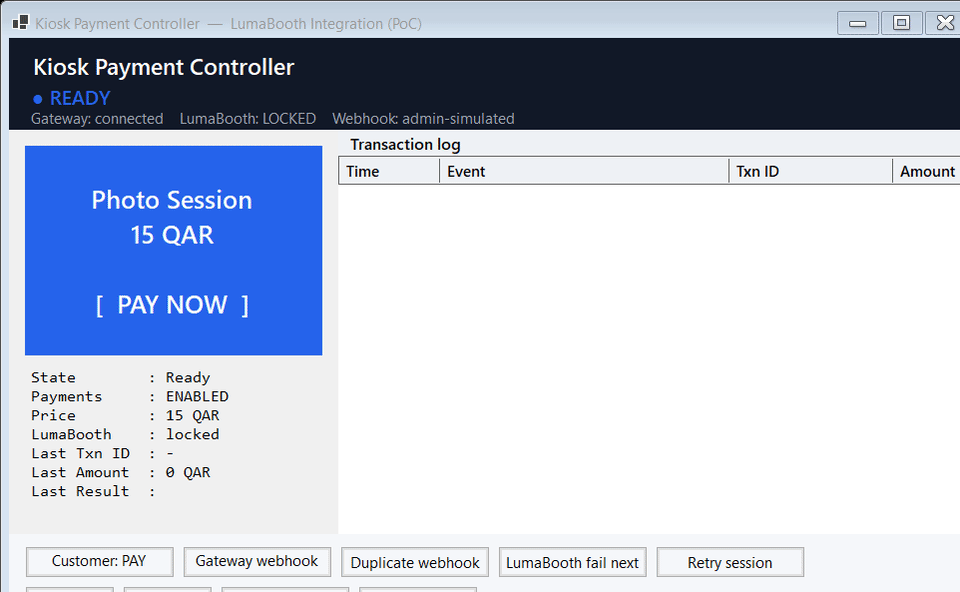

# Kiosk Payment Controller — PoC

A proof-of-concept Windows kiosk controller (C# / .NET WinForms) that bridges a
**payment gateway** and a **photo-booth app (LumaBooth-style)**: one confirmed
payment unlocks exactly **one** photo session, then the booth locks itself again.



The focus is the part that actually goes wrong in production: **webhook idempotency
and failure recovery** — a duplicate payment callback must *never* start a second
session, and a payment that's confirmed but whose session fails must be recoverable.

## What it does

Customer flow, driven by a strict state machine:

```
READY → PAYMENT_PENDING → PAYMENT_CONFIRMED → SESSION_STARTING
      → SESSION_ACTIVE → SESSION_COMPLETE → READY
```

- **Webhook / callback handling** — a real local endpoint (`POST /webhook`) receives
  gateway callbacks; payloads are parsed and drive the state machine.
- **Idempotency** — every processed transaction id is stored (and persisted) *before*
  acting, so duplicate or replayed webhooks are ignored. **One payment = one session.**
- **Mock LumaBooth integration** — `ExitLockScreen` / `StartPrintSession` on confirm,
  lock again when the session ends.
- **Failure recovery** — handles "payment confirmed but session didn't start" with a
  retry path; processed ids are never released, so the payment can't be double-spent.
- **Persistent state** — processed transaction ids and the price survive restarts.
- **Admin panel** — live status, manual lock/unlock, test session, retry, enable/disable
  payments, editable price, and a full transaction log.

## Architecture

| File | Responsibility |
|------|----------------|
| `KioskController.cs` | The state machine, webhook/idempotency logic, mock LumaBooth, persistence — UI-agnostic |
| `WebhookServer.cs`   | Minimal `HttpListener` REST endpoint that feeds callbacks to the controller |
| `MainForm.cs`        | Operator UI: customer screen, status, transaction log, admin controls |

## Run

```
KioskPaymentPoc.exe          # interactive; webhook endpoint on http://localhost:8080/webhook/
```

Send a sandbox payment callback (idempotent — run it twice, only the first starts a session):

```
curl -X POST http://localhost:8080/webhook/ ^
     -H "Content-Type: application/json" ^
     -d "{\"txnId\":\"PMT-TEST-001\",\"amount\":15,\"status\":\"confirmed\"}"
```

## Build

```
dotnet build -c Release
```

Requires the .NET SDK (WinForms target).

## Scope note

This is a PoC of the **first milestone** (sandbox pay → confirm → unlock → session →
lock). The LumaBooth calls and payment gateway are mocked/sandboxed; the production
build swaps in the real LumaBooth API and the chosen gateway (Stripe / Adyen /
Checkout.com / bank acquiring) behind the same interfaces.
